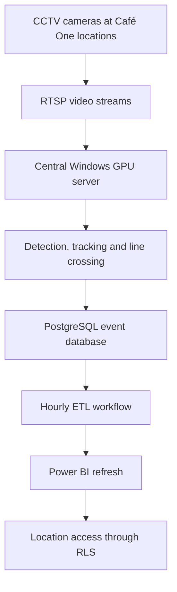

# VisionFootfall: Multi-Location Computer Vision Analytics System

## Overview

VisionFootfall is a production CCTV video-analytics system developed for Café One to measure visitor traffic across approximately 25 locations in Nigeria.

The system processes close to 70 IP-camera streams from location entrances and exits. It detects and tracks people, records line-crossing events, performs temporary same-day facial matching, calculates occupancy and repeat visits, and stores the resulting events in PostgreSQL for reporting.

The project was conceived and led as a personal initiative by Café One's Analytics Engineer, who is responsible for analytics, data science and analytics engineering. It was created to convert existing CCTV infrastructure into structured information for operational and commercial decision-making.

The production system runs on a central Windows server with an NVIDIA GPU. CCTV streams are received through RTSP and processed at approximately 15 frames per second. An hourly ETL workflow prepares the event data, after which Power BI refreshes the reporting model.

> This public repository is a sanitised representation of the production implementation. It excludes real CCTV footage, RTSP addresses, credentials, facial embeddings, production databases and location-specific security information.

## Production Summary

| Area | Production implementation |
| --- | --- |
| Organisation | Café One |
| Deployment | Approximately 25 locations across Nigeria |
| Camera scale | Close to 70 entrance and exit cameras |
| Cameras per location | Usually 2; some locations used 3 or 4 |
| Video protocol | RTSP |
| Processing environment | Central Windows server with an NVIDIA GPU |
| Processing rate | Approximately 15 FPS |
| Person detection | YOLOX-Nano |
| Person tracking | ByteTrack |
| Face detection | YuNet |
| Same-day face matching | SFace embeddings |
| Operational database | PostgreSQL |
| Reporting transformation | Hourly ETL process |
| Dashboard | Power BI, refreshed after the hourly ETL |
| Access control | Power BI row-level security by location |
| Validated counting accuracy | Approximately 85% to 90% under calibrated conditions |
| Temporary identity retention | Deleted at midnight each day |

## Business Purpose

CCTV footage can show what happened, but it does not automatically provide structured measures such as visitor volume, occupancy, repeat activity or peak periods.

VisionFootfall answers questions such as:

- How many distinct visitors entered each location during the day?
- How many physical entries and exits occurred?
- How many people were inside a location at a particular time?
- At what hours was each location busiest?
- How frequently did visitors return during the same day?
- How should staff shifts and other resources be allocated?
- What level of visitor exposure could a location offer an advertising partner?
- How did traffic patterns differ by location, date, day and hour?

The results support employee scheduling, resource allocation, location comparisons, capacity planning and commercial partnership discussions.

## Project Ownership and Role

The project was initiated and led by Café One's Analytics Engineer.

Responsibilities included:

- Identifying the business opportunity and defining the measurement requirements
- Designing the technical and data architecture
- Developing the Python video-analytics application
- Selecting and integrating the detection, tracking and face-matching models
- Defining camera roles and RTSP stream configurations
- Working with technical personnel responsible for physical camera installation
- Calibrating counting lines and thresholds at each location
- Configuring each branch according to its entrance and exit layout
- Designing the PostgreSQL event-storage structure
- Building the ETL workflow used for reporting
- Deploying the application to a central GPU-enabled Windows server
- Developing the Power BI semantic model and reports
- Implementing Power BI row-level security
- Validating system results against manual CCTV review and physical observation
- Defining privacy controls and the daily deletion process for temporary identities

Physical camera installation was completed with technical installation personnel. Camera calibration, analytics configuration, code development, data engineering and reporting were owned by the Analytics Engineer.

## System Architecture



Centralised processing provided one controlled environment for model updates, shared GPU capacity, central logs, PostgreSQL storage and consistent deployment.

It also created a dependency on network access between each branch and the server. RTSP reconnection handling allows an interrupted camera worker to recover without stopping the remaining streams.

## Camera Deployment

The physical layouts were not identical across locations. Each branch was configured according to its doors, entrance width, camera positions and movement patterns.

| Layout | Camera arrangement |
| --- | --- |
| Standard | 1 entry camera and 1 exit camera |
| Wide or divided entrance | 2 entry cameras and 1 exit camera |
| Multiple movement paths | 2 entry cameras and 2 exit cameras |

Each camera had an `entry` or `exit` role. Cameras were positioned to observe people approaching the relevant side of the doorway, while virtual line-crossing logic determined whether movement qualified as an entry or exit.

## Location-Specific Calibration

A single configuration could not be copied unchanged to every location. Calibration covered:

- Virtual counting-line position
- Allowed crossing direction
- Entry or exit role
- Camera resolution and stream stability
- Person-detection confidence
- Face-detection confidence
- Minimum usable face size
- Face-matching threshold
- Frame-processing frequency
- Excluded regions within the camera view
- Lighting and doorway width
- Side-by-side movement
- People waiting or turning around near the line

Camera positioning affected the final result significantly. A suitable view needed to show movement through the doorway and provide a usable facial view without identifying a person by name.

## Video Analytics Pipeline

1. Connect to a configured RTSP stream.
2. Read video frames from the camera.
3. Resize and prepare selected frames for inference.
4. Detect people using YOLOX-Nano.
5. Track detected people using ByteTrack.
6. Detect visible faces using YuNet.
7. Align suitable faces and create SFace embeddings.
8. Monitor each track relative to its configured counting line.
9. Create an entry or exit event when a valid crossing occurs.
10. Compare the embedding with temporary identities already created that day.
11. Apply unique-footfall, occupancy and repeat-visit rules.
12. Write operational events to PostgreSQL.
13. Delete temporary identities at midnight.

## Models and Processing Methods

### YOLOX-Nano

YOLOX-Nano detects people and returns their bounding boxes and confidence scores. It was selected because it provides a practical balance between detection quality and inference speed for multi-camera processing.

The ONNX version can be deployed through ONNX Runtime without loading the original training framework. The reference model uses a 416 by 416 input size.

```text
models/yolox_nano.onnx
```

[Download YOLOX-Nano ONNX](https://github.com/Megvii-BaseDetection/YOLOX/releases/download/0.1.1rc0/yolox_nano.onnx)

### ByteTrack

ByteTrack follows a detected person across consecutive frames. It prevents one person observed repeatedly from being treated as several unrelated detections.

It was selected because it can associate high-confidence and lower-confidence detections, which is useful when people partly overlap at busy entrances. The reference implementation uses ByteTrack through the Python `supervision` package.

### YuNet

YuNet detects faces and facial landmarks. The landmarks allow a face to be aligned before an embedding is created. It was selected as a lightweight detector that integrates directly with OpenCV.

```text
models/face_detection_yunet.onnx
```

[Download YuNet](https://huggingface.co/opencv/face_detection_yunet/resolve/main/face_detection_yunet_2023mar.onnx?download=true)

### SFace

SFace converts an aligned face into a numerical embedding. Embeddings are compared to determine whether a person has already been seen that day.

No name, phone number or customer account is attached to the embedding. The embedding is still treated as sensitive biometric information.

```text
models/face_recognition_sface.onnx
```

[Download SFace](https://huggingface.co/opencv/face_recognition_sface/resolve/main/face_recognition_sface_2021dec.onnx?download=true)

### Geometric line-crossing logic

Line crossing uses geometric rules rather than another trained model. The application compares a tracked person's position with both sides of a configured virtual line.

An event is created only when the track crosses the line in an allowed direction. This reduces counts from people standing near the doorway or moving within view without entering or exiting.

### Same-day similarity matching

SFace embeddings are normalised and compared using a similarity score. A configurable threshold determines whether two observations belong to the same temporary daily identity.

The threshold was calibrated against actual entrance conditions because lighting, face size, camera angle and crowding differed across locations.

## Why Pretrained Models Were Used

The application integrates pretrained models instead of training new neural networks from the beginning.

The main engineering work involved building the production system around them:

- RTSP ingestion
- Concurrent camera workers
- Model inference
- Track management
- Face-to-person association
- Line-crossing detection
- Cross-camera same-day matching
- Business counting rules
- PostgreSQL event storage
- Retention controls
- Stream recovery
- ETL and Power BI integration

No model distillation, automated labelling or anomaly-detection process is claimed in this repository.

## Real-Time Performance and Trade-offs

The production pipeline processed streams at approximately 15 FPS.

Controls used to balance accuracy and GPU demand included:

- Lightweight YOLOX-Nano detection
- 416 by 416 model input
- Processing selected frames rather than every available frame
- Running face detection less frequently than person tracking
- Rejecting faces below a minimum usable size
- Configurable confidence thresholds
- Maintaining tracks between detection results
- Disabling preview windows on the server
- Separate camera workers so one failed stream did not block others

A higher frame rate supplies more observations but consumes more GPU capacity. A lower rate reduces computation but may miss fast movement. Fifteen FPS provided a workable operating point for entrance and exit activity.

### Computer vision latency and reporting latency

| Measurement | Meaning |
| --- | --- |
| Inference latency | Time required to analyse frames |
| Event latency | Time between a crossing and its PostgreSQL event |
| Reporting latency | Time before transformed data appears in Power BI |

The application writes events continuously. The ETL process runs hourly. After the ETL completes, the Power BI refresh begins. Dashboard freshness therefore follows the hourly reporting cycle and is not the same as the speed of the computer vision pipeline.

## Business Definitions

### Daily unique footfall

A recognised person contributes once to daily unique footfall on the first valid entry of the day. Later entries by that person do not increase daily unique footfall.

### Physical entries and exits

Every valid entry increases the physical-entry count. Every valid exit increases the physical-exit count.

### Occupancy

```text
Current occupancy = physical entries - physical exits
```

Occupancy is separate from daily unique footfall. Every valid movement affects occupancy, including a returning visitor.

### Repeat entry and qualified repeat visit

A repeat entry occurs when someone already seen that day enters again. It becomes a qualified repeat visit when the person has been outside for at least two hours. The calculation uses the most recent exit time.

| Time | Event | Daily unique | Physical entry | Occupancy change | Repeat entry | Qualified repeat |
| --- | --- | ---: | ---: | ---: | ---: | ---: |
| 9:00 a.m. | First entry | 1 | 1 | +1 | 0 | 0 |
| 10:00 a.m. | Exit | 0 | 0 | -1 | 0 | 0 |
| 10:30 a.m. | Returns after 30 minutes | 0 | 1 | +1 | 1 | 0 |
| 11:00 a.m. | Exit | 0 | 0 | -1 | 0 | 0 |
| 4:00 p.m. | Returns after five hours | 0 | 1 | +1 | 1 | 1 |

## Daily Operating Schedule

| Time | Activity |
| --- | --- |
| 6:00 a.m. | Processing service becomes active |
| 8:00 a.m. | Business hours begin |
| 9:00 p.m. | Business closes and normal customer movement ends |
| 9:00 p.m. to midnight | Processing remains available, although entrances are locked |
| Midnight | Temporary identities and embeddings are deleted |

A visible face alone does not create a positive entrance count. A tracked person must complete a valid line crossing.

## Example Multi-Camera Configuration

This example contains no production addresses or credentials.

```yaml
location:
  id: EXAMPLE-LOCATION-01
  timezone: Africa/Lagos

operation:
  service_start: "06:00"
  business_start: "08:00"
  business_end: "21:00"
  retention_reset: "00:00"
  repeat_visit_hours: 2
  target_fps: 15
  face_match_threshold: 0.42
  face_detection_threshold: 0.85
  minimum_face_width: 60
  process_every_nth_frame: 2
  face_every_nth_frame: 3
  show_preview: false

models:
  person_detector: models/yolox_nano.onnx
  face_detector: models/face_detection_yunet.onnx
  face_recognizer: models/face_recognition_sface.onnx
  person_input_width: 416
  person_input_height: 416
  person_confidence: 0.35
  person_nms_threshold: 0.45

database:
  host: ${POSTGRES_HOST}
  port: 5432
  name: ${POSTGRES_DB}
  user: ${POSTGRES_USER}
  password: ${POSTGRES_PASSWORD}

cameras:
  - id: EXAMPLE-ENTRY-01
    role: entry
    source: ${EXAMPLE_ENTRY_01_RTSP}
    counting_line: [0.10, 0.60, 0.90, 0.60]
    allowed_crossing: negative_to_positive

  - id: EXAMPLE-EXIT-01
    role: exit
    source: ${EXAMPLE_EXIT_01_RTSP}
    counting_line: [0.10, 0.60, 0.90, 0.60]
    allowed_crossing: positive_to_negative
```

Production addresses and credentials must be supplied through protected environment variables or a secrets-management service.

## Main Code Components

| Component | Responsibility |
| --- | --- |
| Configuration loader | Reads location, camera, model, schedule and threshold settings |
| RTSP camera worker | Reads one stream and handles reconnection |
| Person detector | Runs YOLOX-Nano and returns person boxes |
| Person tracker | Uses ByteTrack to maintain movement tracks |
| Face engine | Detects, aligns and converts suitable faces into embeddings |
| Face-to-track assignment | Associates a face with the correct tracked person |
| Crossing monitor | Detects directional movement across the virtual line |
| Identity matcher | Compares same-day embeddings and assigns temporary IDs |
| Event processor | Applies footfall, occupancy and repeat-visit rules |
| PostgreSQL repository | Writes events, counters and processing status |
| Retention worker | Deletes temporary identities at midnight |
| Health monitor | Records camera connectivity and application status |
| ETL workflow | Prepares event data for reporting |

## Sanitised Repository Structure

```text
vision-footfall-analytics/
|
|-- README.md
|-- requirements.txt
|-- .gitignore
|-- LICENSE
|
|-- config/
|   |-- config.example.yaml
|   |-- locations.example.yaml
|
|-- models/
|   |-- README.md
|   |-- yolox_nano.onnx
|   |-- face_detection_yunet.onnx
|   |-- face_recognition_sface.onnx
|
|-- src/
|   |-- main.py
|   |-- config.py
|   |-- camera_stream.py
|   |-- person_detector.py
|   |-- person_tracker.py
|   |-- face_engine.py
|   |-- crossing_monitor.py
|   |-- identity_matcher.py
|   |-- event_processor.py
|   |-- database.py
|   |-- retention.py
|   |-- health_monitor.py
|
|-- database/
|   |-- schema.sql
|   |-- sample_reporting_queries.sql
|
|-- etl/
|   |-- footfall_reporting_etl.py
|
|-- tests/
|   |-- test_crossing_monitor.py
|   |-- test_identity_matching.py
|   |-- test_occupancy_rules.py
|   |-- test_repeat_visit_rules.py
|   |-- test_retention.py
|
|-- docs/
|   |-- architecture.md
|   |-- calibration.md
|   |-- deployment.md
|   |-- privacy.md
|   |-- powerbi_reporting.md
|
|-- sample_data/
|   |-- synthetic_events.csv
|
|-- data/
|-- logs/
```

The production code may be organised differently. This structure presents the public implementation by responsibility without exposing protected deployment details.

## Technology Stack

| Technology | Use |
| --- | --- |
| Python | Video-analytics and ETL application |
| OpenCV | Video capture, face processing and image operations |
| ONNX Runtime | YOLOX-Nano inference |
| Supervision | ByteTrack integration and detection utilities |
| NumPy | Model outputs and embedding calculations |
| PyYAML | Location and camera configuration |
| PostgreSQL | Central event storage |
| RTSP | Live CCTV video transport |
| Windows Server | Central production host |
| NVIDIA GPU | Multi-stream inference acceleration |
| Power BI | Operational and commercial reporting |
| Power BI RLS | Location-level report access control |

The application does not claim direct TensorFlow or PyTorch use. The pretrained models are deployed through ONNX Runtime and OpenCV.

## PostgreSQL Event Layer

Operational records typically include:

- Location ID
- Camera ID and role
- Event timestamp and direction
- Temporary track reference
- Temporary daily visitor reference
- Match status and detection confidence
- Physical-entry and physical-exit indicators
- Daily-unique indicator
- Repeat-entry and qualified-repeat indicators
- Occupancy after the event
- Camera and processing status

Temporary embeddings are retained only for same-day matching and deleted at midnight. Permanent reporting tables do not need to contain face crops or embeddings.

## ETL and Power BI Reporting

1. Read new and updated PostgreSQL events.
2. Validate location, camera, direction and timestamp fields.
3. Remove duplicate event writes where required.
4. Build hourly traffic measures.
5. Calculate unique footfall, entries, exits, repeat visits and occupancy.
6. Prepare reporting tables.
7. Complete the hourly ETL run.
8. Start the Power BI refresh after ETL completion.

The report supports daily unique footfall, physical movement, occupancy, hourly traffic curves, peak periods, repeat visits, location comparisons and processing exceptions.

### Row-level security

Power BI row-level security limits branch users to their authorised locations. Management users can receive wider network-level access.

The security mapping should use authenticated user identities and an authorised user-to-location table, not only visual filters.

## Accuracy Validation

The complete counting pipeline achieved approximately 85% to 90% accuracy under calibrated conditions.

Validation involved:

1. Selecting defined observation periods.
2. Manually reviewing CCTV footage.
3. Counting entries, exits and distinct visitors.
4. Conducting physical observation during selected periods.
5. Comparing observations with system events.
6. Investigating missed detections, duplicates and incorrect matches.
7. Adjusting lines, directions and thresholds.
8. Repeating the comparison after calibration.

The percentage describes the full counting system. It is not the isolated accuracy of YOLOX, YuNet or SFace.

## RTSP Disconnection Handling

One failed stream does not stop the remaining streams. A camera worker should:

- Detect failed frame reads
- Mark the stream as unavailable
- Close the failed connection
- Wait for a controlled retry interval
- Reconnect to the RTSP source
- Resume without restarting every camera
- Record downtime for review

## ONVIF Scope

ONVIF can discover compatible IP cameras, obtain device information and retrieve available stream profiles.

This project used configured RTSP streams directly. It does not claim ONVIF-based camera discovery or management. ONVIF is not required when the RTSP address is already known.

## Windows Setup

### Requirements

- Windows 10, Windows 11 or Windows Server
- Python 3.10 or another tested compatible version
- NVIDIA driver and compatible GPU runtime
- PostgreSQL development database
- Consent-based test footage or synthetic video

### Create the environment and install packages

```powershell
python -m venv .venv
.\.venv\Scripts\python.exe -m pip install --upgrade pip
.\.venv\Scripts\python.exe -m pip install -r requirements.txt
```

PowerShell activation is optional. Calling the environment's Python executable directly avoids activation-policy errors.

### Example requirements

```text
numpy>=1.26,<3.0
opencv-contrib-python-headless>=4.10
onnxruntime-gpu>=1.18
supervision>=0.24
PyYAML>=6.0
psycopg[binary]>=3.2
python-dotenv>=1.0
```

Pin exact versions after testing them on the target server.

### Example environment variables

```text
POSTGRES_HOST=example-host
POSTGRES_DB=example-database
POSTGRES_USER=example-user
POSTGRES_PASSWORD=replace-locally
EXAMPLE_ENTRY_01_RTSP=rtsp://replace-locally
EXAMPLE_EXIT_01_RTSP=rtsp://replace-locally
```

### Run the application

```powershell
.\.venv\Scripts\python.exe -m src.main --config config\config.example.yaml
```

Adjust the command to match the final public entry point.

## Recommended `.gitignore`

```gitignore
.venv/
.env
.env.*
__pycache__/
*.py[cod]
.vscode/

config/local/
config/production/

videos/
*.mp4
*.avi
*.mov
*.mkv
*.npy
*.npz

data/
logs/
*.sqlite
*.sqlite3
*.db

models/*.onnx

*.pem
*.key
*.crt
```

## Privacy and Security

Controls include:

- No public release of production CCTV footage
- No face photographs stored for normal matching
- Temporary embeddings separated from permanent traffic events
- Deletion of temporary identities and embeddings at midnight
- No cross-day identity recognition
- No customer names attached to embeddings
- Restricted server and database access
- Protected RTSP and database credentials
- Location-level Power BI row-level security
- No production data or secrets committed to GitHub
- Synthetic events and example configurations in the public repository
- Internal governance and applicable Nigerian data-protection review

Daily deletion reduces retention risk, but temporary embeddings must still be protected as sensitive biometric information while they exist.

## Why Production Videos Are Not Included

Calibration and validation footage cannot be published because it contains security-sensitive views of Café One locations and may include identifiable visitors and employees.

Publishing it could expose camera positions, entrance layouts, movement patterns, network details and organisational security controls. The public repository therefore uses synthetic events, diagrams and example configurations.

## Current Limitations

- Poor lighting and unsuitable camera angles reduce performance.
- Face coverings or people looking away may prevent same-day matching.
- Crowded entrances may cause missed or duplicate counts.
- A physical crossing can be recorded when no usable face is available.
- Occupancy can drift when an entry or exit is missed.
- Processing depends on connectivity between each location and the server.
- Temporary facial matching can produce false or missed matches.
- Staff cannot always be separated from customers without another approved method.
- Power BI follows the hourly reporting cycle rather than second-by-second activity.
- The project does not perform behaviour or anomaly detection.

## Production Monitoring

Recommended monitoring includes:

- RTSP camera availability
- Frames received and processed per second
- Inference errors
- PostgreSQL connectivity
- Event-write failures
- GPU memory and utilisation
- ETL completion
- Power BI refresh status
- Temporary identity deletion
- Daily entry and exit imbalance

## Repository Boundaries

The public repository may contain sanitised code, example configuration, database schemas, synthetic events, tests, model download instructions and architecture documentation.

It must not contain production footage, face crops, embeddings, RTSP addresses, credentials, production databases, internal server addresses, real location security configurations or Power BI access mappings.

## Project Status

VisionFootfall progressed from a personal analytics initiative into a centrally processed, multi-location video-analytics deployment supporting approximately 25 Café One locations and close to 70 camera streams.

The public repository documents the architecture, implementation approach, counting rules, deployment considerations and privacy controls while withholding production data and security-sensitive materials.

## Author

Designed and implemented by the Analytics Engineer responsible for analytics, data science and analytics engineering at Café One.
