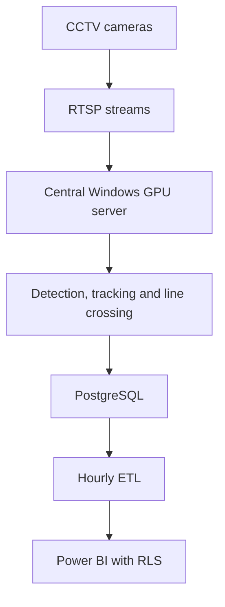

# VisionFootfall: Multi-Location Computer Vision Analytics

VisionFootfall is a CCTV video-analytics system developed for Café One to measure visitor traffic across approximately 25 locations in Nigeria.

Close to 70 entrance and exit cameras stream video to a central Windows server through RTSP. The application detects and tracks people, records directional line crossings, performs temporary same-day facial matching and stores traffic events in PostgreSQL. An hourly ETL process prepares the data for Power BI reporting.

> This repository is a sanitised version of the production implementation. CCTV footage, credentials, facial embeddings, production databases and location-specific security information are excluded.

## Production Summary

| Area | Implementation |
| --- | --- |
| Deployment | Approximately 25 Café One locations |
| Camera scale | Close to 70 cameras, usually 2 to 4 per location |
| Video ingestion | RTSP |
| Processing | Central Windows server with NVIDIA GPU |
| Processing rate | Approximately 15 FPS |
| Person detection | YOLOX-Nano |
| Tracking | ByteTrack |
| Face detection | YuNet |
| Same-day matching | SFace embeddings |
| Event storage | PostgreSQL |
| Reporting | Hourly ETL followed by Power BI refresh |
| Access control | Power BI row-level security by location |
| Validated accuracy | Approximately 85% to 90% |
| Identity retention | Temporary records deleted at midnight |

## Business Objective

The project converts CCTV movement into measures used for:

- Daily unique footfall
- Physical entries and exits
- Current and peak occupancy
- Hourly traffic and peak periods
- Same-day repeat visits
- Location comparison
- Staff and resource planning
- Advertising and partnership discussions

A visitor contributes once to daily unique footfall. Every valid entry or exit still affects occupancy. A return is recorded separately, and it becomes a qualified repeat visit when the person has been outside for at least two hours.

## My Role

I initiated and led the project as Café One's Analytics Engineer. My responsibilities covered:

- Business requirements and system architecture
- Python application development
- Model selection and integration
- RTSP and camera-role configuration
- Location-level calibration
- PostgreSQL event design
- Hourly ETL development
- Central server deployment
- Power BI modelling, reporting and row-level security
- Manual validation and performance review
- Daily biometric-retention controls

Technical installation personnel handled the physical camera installation. I handled the analytics configuration, calibration, software, data pipeline and reporting.

## Architecture



Central processing allowed model updates, stream monitoring, storage and reporting to be managed from one environment. Camera workers reconnect automatically after an RTSP interruption, so one unavailable stream does not stop the remaining cameras.

## Camera Layout and Calibration

Camera layouts differed by location:

| Layout | Camera arrangement |
| --- | --- |
| Standard entrance | 1 entry and 1 exit camera |
| Wide or divided entrance | 2 entry and 1 exit camera |
| Multiple movement paths | 2 entry and 2 exit cameras |

Each camera was assigned an `entry` or `exit` role. Calibration covered:

- Counting-line position
- Allowed crossing direction
- Detection and face-matching thresholds
- Minimum usable face size
- Frame-processing frequency
- Lighting, doorway width and camera angle
- Side-by-side movement and partial obstruction
- People waiting or turning near the line

A face appearing in the frame does not create a count. The tracked person must cross the configured line in an allowed direction.

## Video Analytics Pipeline

1. Read a camera's RTSP stream.
2. Detect people with YOLOX-Nano.
3. Maintain movement tracks with ByteTrack.
4. Detect and align visible faces with YuNet.
5. Generate temporary SFace embeddings.
6. Associate each face with the correct person track.
7. Detect a valid directional line crossing.
8. Match the embedding against identities already seen that day.
9. Apply the footfall, occupancy and repeat-visit rules.
10. Write the event to PostgreSQL.
11. Delete temporary identities at midnight.

## Models and Processing Logic

| Component | Function | Reason for selection |
| --- | --- | --- |
| YOLOX-Nano | Person detection | Lightweight ONNX model suited to multi-stream inference |
| ByteTrack | Multi-object tracking | Maintains tracks through high- and lower-confidence detections |
| YuNet | Face detection and landmarks | Lightweight and integrated with OpenCV |
| SFace | Facial embeddings | Efficient same-day similarity matching through OpenCV |
| Geometric line crossing | Entry and exit event logic | Prevents people standing near a door from being counted |

Model files:

- [`yolox_nano.onnx`](https://github.com/Megvii-BaseDetection/YOLOX/releases/download/0.1.1rc0/yolox_nano.onnx)
- [`face_detection_yunet.onnx`](https://huggingface.co/opencv/face_detection_yunet/resolve/main/face_detection_yunet_2023mar.onnx?download=true)
- [`face_recognition_sface.onnx`](https://huggingface.co/opencv/face_recognition_sface/resolve/main/face_recognition_sface_2021dec.onnx?download=true)

The application uses pretrained models through ONNX Runtime and OpenCV. The main engineering work was the live-stream pipeline, tracking, cross-camera matching, counting rules, retention, storage and reporting integration. The project does not claim model training, model distillation, automated labelling or anomaly detection.

## Performance and Reporting Latency

The production streams were processed at approximately 15 FPS. GPU demand was controlled through:

- A lightweight 416 × 416 person-detection model
- Configurable frame selection
- Less frequent face detection than person tracking
- Minimum face-size and confidence thresholds
- Headless server processing
- Independent camera workers

The computer vision application records events continuously. Reporting follows a separate hourly cycle:

```text
Crossing event → PostgreSQL → hourly ETL → Power BI refresh
```

The dashboard delay therefore comes from the reporting cycle, not the speed of the detection pipeline.

## Counting Rules

| Measure | Rule |
| --- | --- |
| Daily unique footfall | First recognised entry by a person that day |
| Physical entries | Every valid entry crossing |
| Physical exits | Every valid exit crossing |
| Occupancy | Physical entries minus physical exits |
| Repeat entry | Entry by someone already seen that day |
| Qualified repeat visit | Repeat entry after at least two hours outside |

The two-hour rule uses the most recent exit time. Returning after two hours does not increase daily unique footfall, but it increases the qualified repeat-visit measure and occupancy.

## Operating Schedule

| Time | Activity |
| --- | --- |
| 6:00 a.m. | Processing service starts |
| 8:00 a.m. | Business hours begin |
| 9:00 p.m. | Business closes |
| Midnight | Temporary identities and embeddings are deleted |

Processing remains available until midnight, although locked entrances prevent normal customer crossings after closing.

## Data and Reporting

PostgreSQL stores:

- Location, camera and event timestamps
- Entry or exit direction
- Identity-match status
- Detection confidence
- Unique and repeat-visit indicators
- Occupancy after each event
- Camera and processing status

Temporary embeddings are stored separately from permanent traffic events and removed at midnight.

The hourly ETL creates reporting tables for traffic, occupancy, repeat visits and location comparison. Power BI refreshes after the ETL completes. Row-level security restricts branch users to their authorised locations while management can view the full network.

## Example Configuration

```yaml
location:
  id: EXAMPLE-LOCATION-01
  timezone: Africa/Lagos

operation:
  processing_start: "06:00"
  processing_end: "00:00"
  business_start: "08:00"
  business_end: "21:00"
  target_fps: 15
  repeat_visit_hours: 2
  face_match_threshold: 0.42
  face_detection_threshold: 0.85
  minimum_face_width: 60
  process_every_nth_frame: 1
  face_every_nth_frame: 3

database:
  driver: postgresql
  dsn: ${FOOTFALL_POSTGRES_DSN}

cameras:
  - id: ENTRY-01
    role: entry
    source: ${ENTRY_01_RTSP}
    counting_line: [0.10, 0.60, 0.90, 0.60]
    allowed_crossing: negative_to_positive

  - id: EXIT-01
    role: exit
    source: ${EXIT_01_RTSP}
    counting_line: [0.10, 0.60, 0.90, 0.60]
    allowed_crossing: positive_to_negative
```

Production addresses and credentials are supplied through protected environment variables.

## Repository Structure

```text
vision-footfall-analytics/
├── README.md
├── requirements.txt
├── pyproject.toml
├── .env.example
├── config/
│   ├── config.example.yaml
│   └── config.local.example.yaml
├── models/
│   └── README.md
├── src/vision_footfall/
│   ├── __main__.py
│   ├── application.py
│   ├── camera.py
│   ├── config.py
│   ├── crossing.py
│   ├── detection.py
│   ├── embeddings.py
│   ├── entities.py
│   ├── faces.py
│   ├── postgres_repository.py
│   ├── repository.py
│   ├── retention.py
│   ├── sqlite_repository.py
│   └── tracking.py
├── database/
│   └── schema.sql
├── etl/
│   └── footfall_reporting_etl.py
└── tests/
    ├── test_config.py
    ├── test_crossing.py
    └── test_sqlite_repository.py
```

SQLite is included for local and recorded-video testing. PostgreSQL is used for the central deployment.

## Validation and Tests

Automated counts were compared with manual CCTV review and physical observation during selected periods. After location-specific calibration, the complete counting pipeline achieved approximately 85% to 90% accuracy.

The automated test suite covers:

- Multi-camera configuration validation
- Directional line crossing
- Daily unique counting
- Entry, exit and occupancy updates
- Two-hour repeat-visit logic
- Midnight identity deletion

## Privacy and Repository Boundaries

Temporary facial embeddings are used only for same-day matching. They are not linked to names, phone numbers or customer accounts, and cross-day recognition is not performed.

The repository does not include:

- Production CCTV or calibration footage
- Face images or embeddings
- RTSP addresses and camera credentials
- Production databases
- Server and network details
- Power BI access mappings

Production footage cannot be shared because it may identify visitors and employees and expose camera positions, entrance layouts and other security information.

## Limitations

- Lighting, camera angle, face visibility and crowding affect accuracy.
- Occupancy can drift when an entry or exit is missed.
- Staff cannot always be separated from customers without another approved method.
- Power BI follows the hourly reporting cycle rather than second-by-second activity.

## Status

VisionFootfall progressed from a personal analytics initiative into a centrally processed deployment supporting approximately 25 Café One locations and close to 70 camera streams.

Designed and implemented by Café One's Analytics Engineer.

